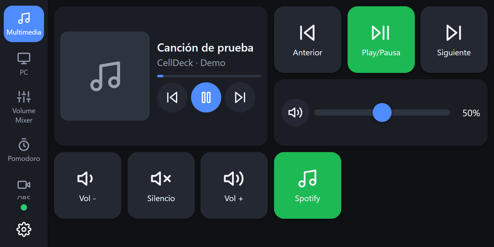
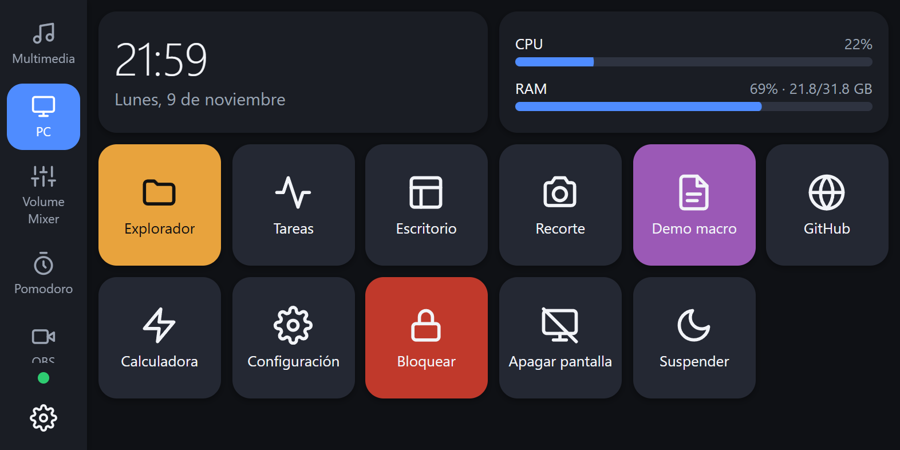
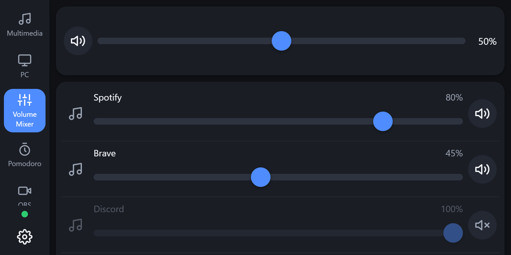
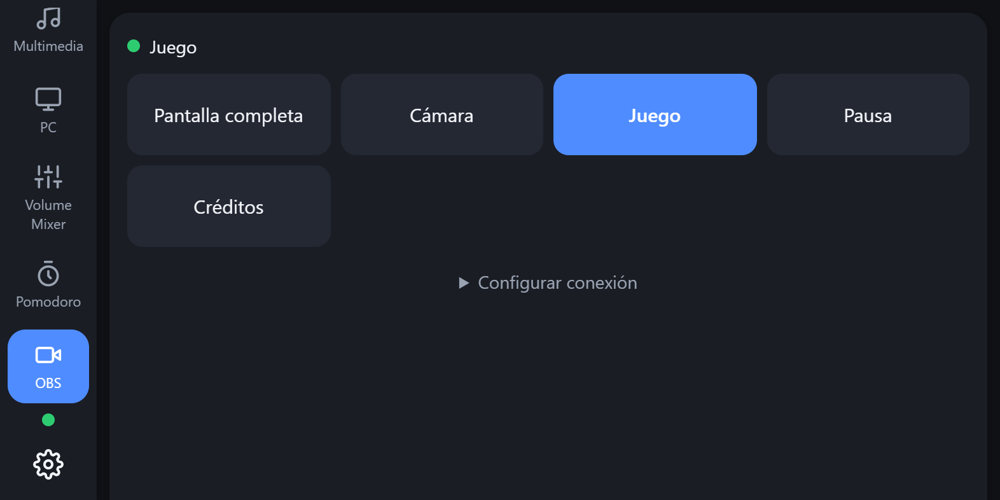
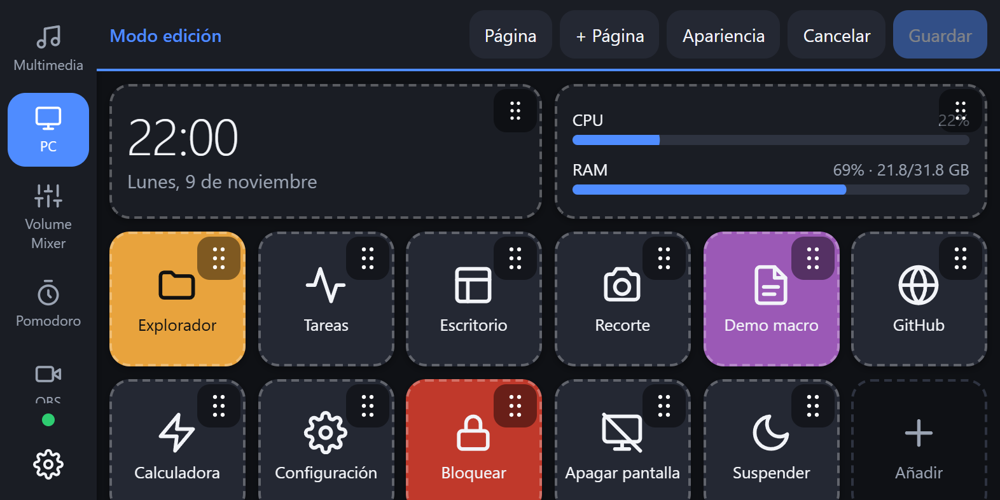
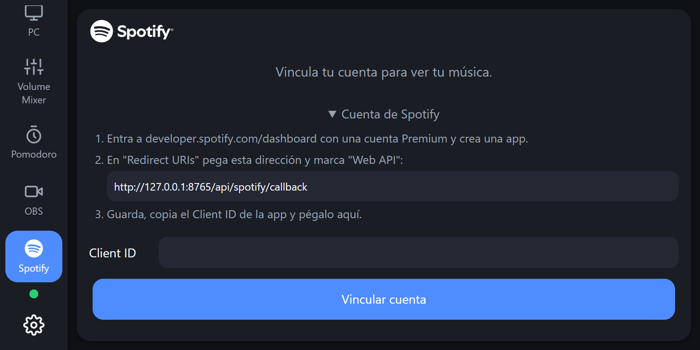

# CellDeck

**Turn any phone into a control panel for your Windows PC.** It works like a Stream Deck, but
it's free and runs on that old phone sitting in a drawer.

**Nothing to install on the phone:** it opens a web page served by your PC, over USB or WiFi. It
works on old Android phones (Chrome 60), new phones, tablets, iPhone and iPad.

> The app's interface and most of the docs are in Spanish. [Versión en español](README.md)

<table>
  <tr><th width="50%">🎵 Media</th><th width="50%">🖥️ PC</th></tr>
  <tr><td></td><td></td></tr>
  <tr><td align="center"><sub>Current song with cover art, controls and volume</sub></td><td align="center"><sub>Clock, live CPU/RAM and Windows actions</sub></td></tr>
  <tr><th width="50%">🔊 Volume Mixer</th><th width="50%">🎬 OBS</th></tr>
  <tr><td></td><td></td></tr>
  <tr><td align="center"><sub>Per-app volume and mute</sub></td><td align="center"><sub>One button per scene, the active one highlighted</sub></td></tr>
  <tr><th width="50%">✏️ Edit mode</th><th width="50%">🟢 Spotify</th></tr>
  <tr><td></td><td></td></tr>
  <tr><td align="center"><sub>Drag to move, tap to change label, icon, color and action</sub></td><td align="center"><sub>Link with your own Client ID, then browse playlists, search and queue</sub></td></tr>
</table>

## Features

- **Media:** play/pause, previous and next, with the current song and its cover art.
- **Volume:** master volume slider and a per-app **Volume Mixer**.
- **PC:** launch programs, folders and URLs, keyboard shortcuts, lock, turn off the display,
  sleep. Live CPU, RAM and clock.
- **Installed apps:** Steam, Epic Games, Visual Studio, VS Code and Brave, found automatically
  and shown with their official logo.
- **Macros:** several actions in a row with a single tap.
- **Pomodoro timer**, **OBS scene switching** (optional) and **Spotify** (optional, with your own
  account).
- **Visual editor:** build your own buttons and pages. Choose from 69 icons or the app's logo,
  and pick colors and sizes.

## Download

Requires Windows 10/11, 64-bit. No Python needed.

1. Go to **[Releases](../../releases/latest)** and download one of these:
   - **`CellDeck.exe`**: a single portable file.
   - **`CellDeck-win64.zip`**: the same app as a folder. It starts faster and antivirus tools
     flag it less often.
2. Run it. An icon appears next to the Windows clock. Right-click it for the menu.

**"Windows protected your PC":** the executable is not code-signed, so SmartScreen may warn you
the first time. Click **More info** and then **Run anyway**. To check the file, compare it with
`SHA256SUMS.txt`, or verify the build attestation:
`gh attestation verify CellDeck.exe --repo IngMaciasY/CellDeck`.

## Connect your phone

- **USB (Android, the safest option):** enable USB debugging, install
  [adb](https://developer.android.com/tools/releases/platform-tools), then use tray icon →
  **Conectar celular por USB**. If the page doesn't open by itself, browse to
  `http://localhost:8765` on the phone. See [docs/usb.md](docs/usb.md).
- **WiFi (any phone):** both devices must be on the same network. Use tray icon →
  **Modo WiFi**, then **Mostrar QR / PIN**. Scan the QR code and enter the 6-digit PIN.

## Optional integrations

- **OBS 28+:** enable the WebSocket server in OBS and paste its password on CellDeck's OBS page.
- **Spotify:** requires Premium and your own free app from the
  [Spotify developer dashboard](https://developer.spotify.com/dashboard). In development mode,
  Spotify allows only 5 users per app, so there is no shared Client ID. See
  [docs/spotify.md](docs/spotify.md).

Your settings and secrets live only on your PC, in `%APPDATA%\CellDeck`. CellDeck has no
telemetry and doesn't use external servers.

**Used PhoneDeck before?** That was this project's previous name. The first time CellDeck
runs, it copies your data from `%APPDATA%\PhoneDeck`, which stays as a backup. Your phone stays
paired and the start-with-Windows entry moves to CellDeck.

## Development

```bat
git clone https://github.com/IngMaciasY/CellDeck.git
cd CellDeck
py -3.13 -m venv .venv
.venv\Scripts\python -m pip install -e .[dev]
scripts\dev.bat --fake --no-tray      :: demo mode, touches nothing on your system
.venv\Scripts\python -m pytest
```

Build the executable with `scripts\build.bat`, then `scripts\package_release.ps1`. Pushing a
`vX.Y.Z` tag builds a draft release on GitHub Actions; see [docs/RELEASING.md](docs/RELEASING.md).

Contributions are welcome. Read [CONTRIBUTING.md](CONTRIBUTING.md); issues and PRs in English
are fine. Report security issues privately, as described in [SECURITY.md](SECURITY.md).

## License

[MIT](LICENSE)
