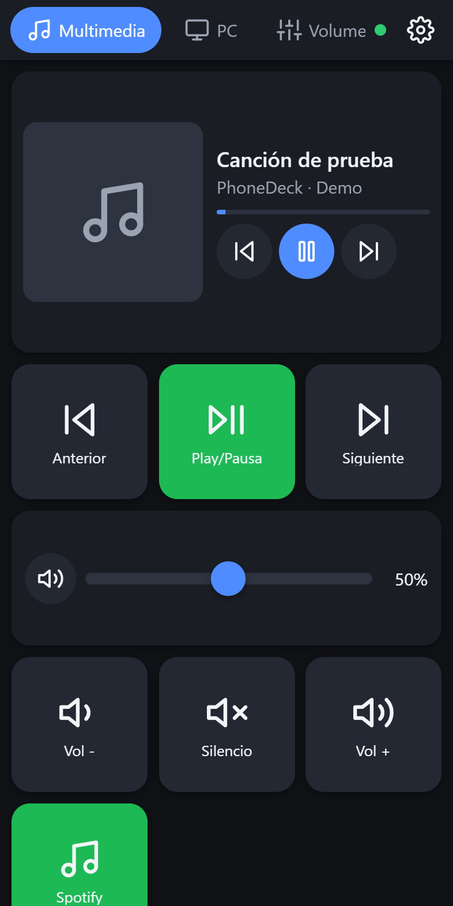
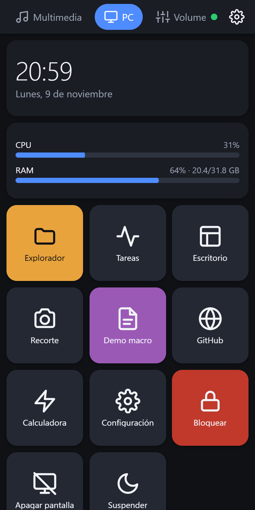
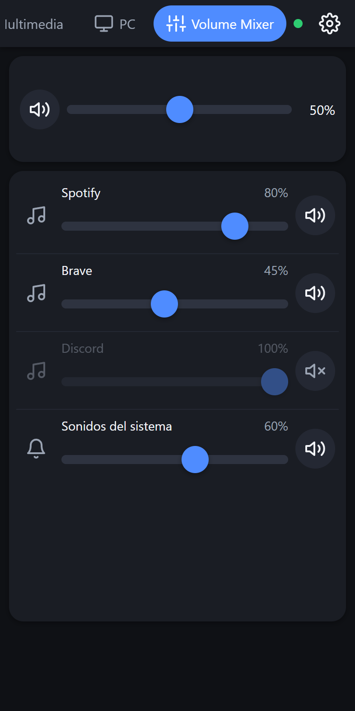
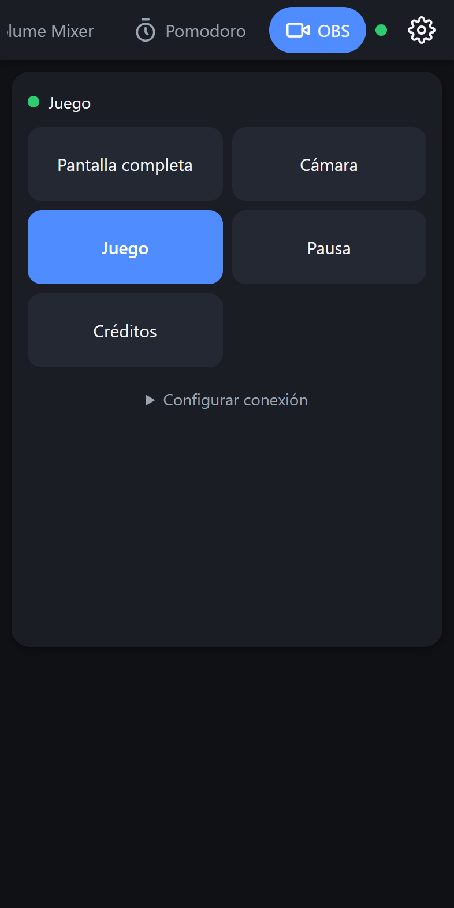
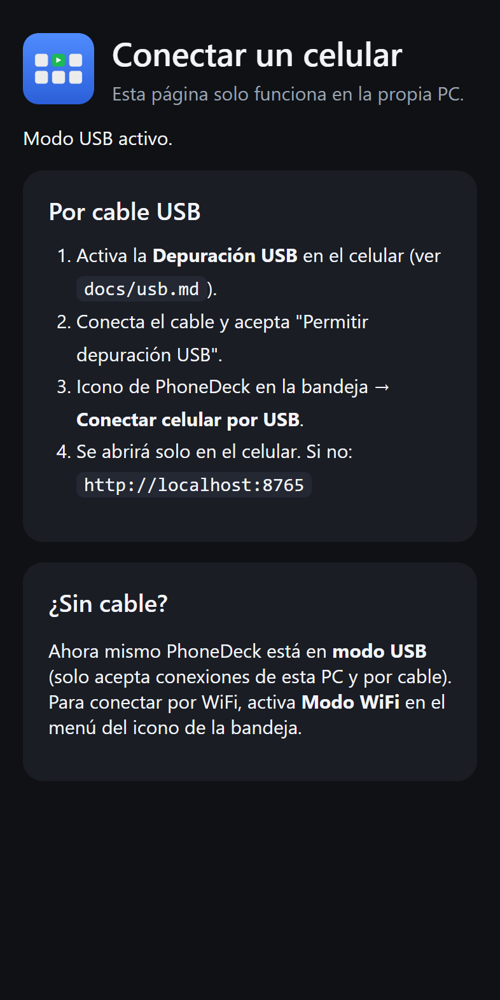
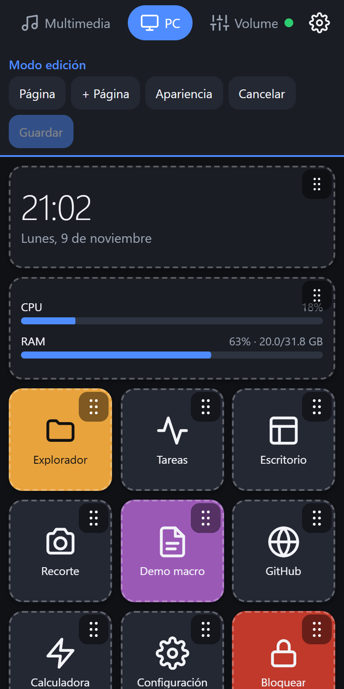
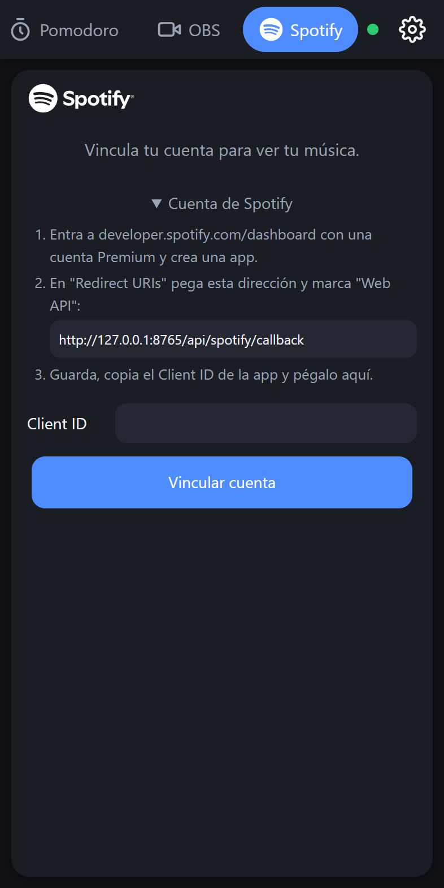

# PhoneDeck

**Convierte cualquier celular en un panel de control para tu PC con Windows.** Funciona como un
Stream Deck, pero gratis y usando un teléfono viejo que tengas en un cajón.

En el celular **no se instala nada**: abre una página web que sirve tu PC, por cable USB o por
WiFi. Funciona desde Android antiguos (Chrome 60) hasta celulares nuevos, tablets, iPhone y iPad.

[](../../actions/workflows/ci.yml)
[](../../releases/latest)
[](LICENSE)

[English version](README.en.md)

<p align="center">
  
  
  
  
</p>

---

## Contenido

- [Qué puedes hacer](#qué-puedes-hacer)
- [Descargar e instalar](#descargar-e-instalar) (para todos)
- [Usarlo desde el celular](#usarlo-desde-el-celular)
- [Personalizar](#personalizar)
- [Integraciones opcionales: OBS y Spotify](#integraciones-opcionales)
- [Seguridad y privacidad](#seguridad-y-privacidad)
- [Para desarrolladores](#para-desarrolladores)
- [Preguntas frecuentes](#preguntas-frecuentes)

---

## Qué puedes hacer

| | |
|---|---|
| 🎵 **Multimedia** | Play/pausa, anterior y siguiente, con la canción que suena y su portada. Funciona con Spotify, YouTube en el navegador, VLC… |
| 🔊 **Volumen** | Volumen general con un deslizador y **Volume Mixer** por aplicación (Discord más bajo, el juego más alto). |
| 🖥️ **PC** | Abrir programas, carpetas y webs, atajos de teclado, bloquear, apagar la pantalla, suspender. CPU, RAM y reloj en vivo. |
| 🎮 **Apps instaladas** | Botones para Steam, Epic Games, Visual Studio, VS Code o Brave que las encuentran solos, estén donde estén, y muestran su logotipo. |
| ⚡ **Macros** | Varias acciones seguidas con un toque: abrir un programa, esperar y escribir un texto. |
| ⏱️ **Pomodoro** | Temporizador de trabajo y descanso, con aviso en el celular y en Windows. |
| 🎬 **OBS** | Cambiar de escena (opcional). |
| 🟢 **Spotify** | Tus playlists, búsqueda y la cola (opcional, con tu propia cuenta). |
| ✏️ **Editor visual** | Crea tus botones y páginas desde el celular o la PC. Elige entre más de 60 iconos o el logotipo de la app, y cambia colores y tamaños. |

---

## Descargar e instalar

**Requisitos:** Windows 10 u 11 de 64 bits. No hace falta Python ni nada más.

1. Entra a **[Releases](../../releases/latest)** y descarga una de estas dos opciones:
   - **`PhoneDeck.exe`**: un solo archivo. Lo pones donde quieras y lo abres.
   - **`PhoneDeck-win64.zip`**: la misma app en una carpeta. Arranca más rápido y los antivirus
     la marcan menos. Descomprímela y abre `PhoneDeck\PhoneDeck.exe`.
2. Ábrelo. Aparecerá un icono junto al reloj de Windows. Clic derecho en él para ver el menú.

### "Windows protegió tu PC"

La primera vez, Windows SmartScreen puede mostrar este aviso. Aparece porque el ejecutable **no
está firmado con un certificado de pago**, no porque se haya detectado nada. Para continuar:

1. Pulsa **Más información**.
2. Pulsa **Ejecutar de todas formas**.

Si quieres comprobar que el archivo es el original, compara su huella con la de
`SHA256SUMS.txt` de la Release. En PowerShell:

```powershell
Get-FileHash .\PhoneDeck.exe -Algorithm SHA256
```

Cada Release también lleva una **atestación de GitHub** que demuestra que el .exe se compiló a
partir de este código público:

```
gh attestation verify PhoneDeck.exe --repo IngMaciasY/PhoneDeck
```

### Actualizar o desinstalar

- **Actualizar:** cierra PhoneDeck (icono de la bandeja → **Salir**) y reemplaza el .exe por el
  nuevo. Tu configuración se conserva.
- **Desinstalar:** desactiva **Iniciar con Windows**, sal y borra el .exe. Si además quieres
  borrar tu configuración, elimina la carpeta `%APPDATA%\PhoneDeck`.

---

## Usarlo desde el celular



Hay dos formas. **Por cable es la más segura**: nadie más de la red puede conectarse.

### Opción 1: por cable USB (Android)

1. Activa la **Depuración USB** en el celular (Ajustes → Acerca del teléfono → toca 7 veces
   *Número de compilación*, y después Opciones de desarrollador → Depuración USB).
2. Instala **adb** en la PC
   ([Android Platform Tools](https://developer.android.com/tools/releases/platform-tools)).
3. Conecta el cable y acepta *Permitir depuración USB* en el celular.
4. Icono de la bandeja → **Conectar celular por USB**. Se abrirá solo en el celular.
   Si no, abre Chrome en el celular y escribe **`http://localhost:8765`** (con el `http://`).

Guía completa, con trucos para Xiaomi y otra opción sin adb: [docs/usb.md](docs/usb.md).

### Opción 2: por WiFi (Android, iPhone, iPad, tablets)

1. La PC y el celular deben estar en **la misma red WiFi**.
2. Icono de la bandeja → **Modo WiFi**. Windows puede preguntar si permites el acceso a la red:
   elige **redes privadas**.
3. Icono de la bandeja → **Mostrar QR / PIN**.
4. Escanea el QR con la cámara del celular e introduce el PIN de 6 dígitos.

Usa el modo WiFi solo en redes de confianza (tu casa), no en redes públicas.

### Consejos

- **Pantalla completa:** ⚙️ → **Pantalla completa**, o en Chrome ⋮ → **Añadir a pantalla de
  inicio** para abrirlo como una app.
- **La pantalla no se apaga** mientras PhoneDeck está abierto.
- **Desliza a izquierda o derecha** para cambiar de página.

<br clear="right">

---

## Personalizar



Toca ⚙️ → **Editar** (en la PC, o en el celular conectado por USB):

- **Botones:** elige la acción, el texto, el **icono** (más de 60, o el logotipo real de la
  aplicación) y el color.
- **Widgets:** canción actual, volumen, CPU/RAM, reloj, mixer, Pomodoro, OBS, Spotify.
- **Páginas:** crea, renombra y reordena. Arrastra los elementos para moverlos.
- **Apariencia:** tema claro u oscuro, color de acento, tamaño de los botones, columnas.

Acciones disponibles para un botón:

| Acción | Ejemplo |
|---|---|
| Multimedia | Play/pausa, siguiente, anterior |
| Volumen | Subir 5 %, silenciar |
| Abrir programa o carpeta | `calc.exe`, `%USERPROFILE%\Downloads` |
| Aplicación instalada | Steam, Epic Games, Visual Studio, VS Code, Brave (sin rutas) |
| Enlace | `https://…`, `ms-settings:`, `spotify:`, `steam://…` |
| Atajo de teclado | `ctrl+shift+esc`, `win+d`, o escribir un texto |
| Macro | Varias acciones con esperas entre medias |
| Sistema | Bloquear, apagar la pantalla, suspender |

La configuración se guarda solo en tu PC, en `%APPDATA%\PhoneDeck`. Opciones avanzadas:
[docs/configuracion.md](docs/configuracion.md).

<br clear="right">

---

## Integraciones opcionales

Vienen desactivadas. No se conectan a nada hasta que tú las configuras.

### OBS Studio (28 o posterior)

1. En OBS: **Herramientas → Ajustes del servidor WebSocket** → activa el servidor y copia la
   contraseña.
2. En PhoneDeck, abre la página **OBS** desde la PC o por USB → **Configurar conexión** → pega
   la contraseña. Por seguridad, este formulario no aparece por WiFi.

PhoneDeck se conecta a OBS desde la propia PC, así que OBS no necesita abrirse a la red.

### Spotify



Muestra tus playlists, tus canciones guardadas y la búsqueda, y controla lo que suena en la PC.
Necesitas:

- Una cuenta **Spotify Premium** (Spotify la exige para controlar la reproducción).
- Crear una app gratuita en el
  [panel de desarrolladores de Spotify](https://developer.spotify.com/dashboard) y pegar su
  **Client ID** en PhoneDeck.

**¿Por qué cada uno crea su propia app?** Spotify limita a 5 usuarios cada app en modo de
desarrollo, así que un Client ID común dejaría de funcionar enseguida. El tuyo se guarda solo en
tu PC.

Guía paso a paso: [docs/spotify.md](docs/spotify.md).

*Spotify es una marca de Spotify AB. Este proyecto no está afiliado a Spotify y su logotipo no
forma parte de la licencia MIT.*

<br clear="right">

---

## Seguridad y privacidad

- Por defecto solo acepta **conexiones por cable o desde la propia PC**.
- Por WiFi exige **PIN** y cada celular recibe un token. Desde la bandeja puedes desconectarlos
  a todos.
- La **edición por WiFi** está desactivada salvo que la actives.
- **No hay servidores externos ni telemetría.** Todo ocurre entre tu PC y tu celular. Spotify y
  OBS solo se usan si los configuras.

Para reportar una vulnerabilidad: [SECURITY.md](SECURITY.md).

---

## Para desarrolladores

**Stack:** Python 3.13 + FastAPI + WebSocket en la PC. HTML, CSS y JavaScript sin frameworks
(compatible con Chrome 60) en el celular. PyInstaller para el .exe.

### Preparar el entorno

Requisitos: Windows 10/11, [Python 3.13](https://www.python.org/downloads/),
[Git](https://git-scm.com/) y, solo para el lint del frontend, [bun](https://bun.sh).

```bat
git clone https://github.com/IngMaciasY/PhoneDeck.git
cd PhoneDeck
py -3.13 -m venv .venv
.venv\Scripts\python -m pip install -e .[dev]
```

### Ejecutar

```bat
scripts\dev.bat --fake --no-tray   :: modo demo: backend simulado, no toca tu sistema
scripts\dev.bat                    :: backend real de Windows, con icono en la bandeja
```

Abre `http://localhost:8765` en el navegador. Para probar acciones sin celular:
`.\scripts\try_action.ps1 -List`.

### Comprobar

```bat
.venv\Scripts\ruff check src tests plugins scripts
.venv\Scripts\mypy
.venv\Scripts\python -m pytest
bun install --frozen-lockfile && bun run lint   :: compatibilidad con Chrome 60
```

### Compilar el ejecutable

```bat
scripts\build.bat                                                   :: dist\PhoneDeck.exe
powershell -ExecutionPolicy Bypass -File scripts\package_release.ps1 :: release\ (exe, zip, SHA-256)
```

Las dependencias del .exe están fijadas por versión y hash en `requirements\build.lock` y se
auditan con `pip-audit`. Cómo publicar una versión: [docs/RELEASING.md](docs/RELEASING.md).

### Estructura

```
src/phonedeck/      servidor: API, WebSocket, seguridad, bandeja
  platform/         capa de Windows (audio, teclado, apps) y backend simulado
  plugins/          acciones de los botones (media, volume, launch, keys, macro…)
  services/         datos en vivo (canción actual, CPU/RAM, mixer, Pomodoro)
  config/           modelos, configuración de fábrica y migraciones
web/                interfaz del celular (sin dependencias en ejecución)
plugins/            ejemplo de plugin externo
tests/              pytest (incluye OBS y Spotify simulados)
scripts/            desarrollo, compilación y capturas
docs/               guías (USB, Spotify, configuración, publicación)
```

### Contribuir

1. Haz un fork y crea una rama: `git switch -c feat/mi-idea`.
2. Haz commits con [Conventional Commits](https://www.conventionalcommits.org/es/).
3. Abre un Pull Request: la CI ejecuta lint, tipos y tests.

Los detalles están en [CONTRIBUTING.md](CONTRIBUTING.md). Las decisiones de diseño y sus
alternativas descartadas están en [DECISIONS.md](DECISIONS.md).

---

## Preguntas frecuentes

**¿Funciona en Mac o Linux?** La PC debe tener Windows. El celular puede ser cualquiera con
navegador.

**¿Necesito internet?** No. Solo la red local o el cable. Spotify sí necesita internet.

**El celular dice "Invalid HTTP request" o no carga.** Escribe la dirección con `http://`
delante. Sin eso, Chrome intenta `https` y falla.

**El antivirus borró PhoneDeck.exe.** Es un falso positivo frecuente con programas hechos con
PyInstaller. Prueba la versión `.zip`, comprueba el SHA-256 o compílalo tú mismo desde el código.

**¿Dónde están mis botones?** En `%APPDATA%\PhoneDeck\config.json`. Se hace una copia en
`backups\` cada vez que guardas.

---

## Licencia

[MIT](LICENSE). Úsalo, modifícalo y compártelo libremente.
